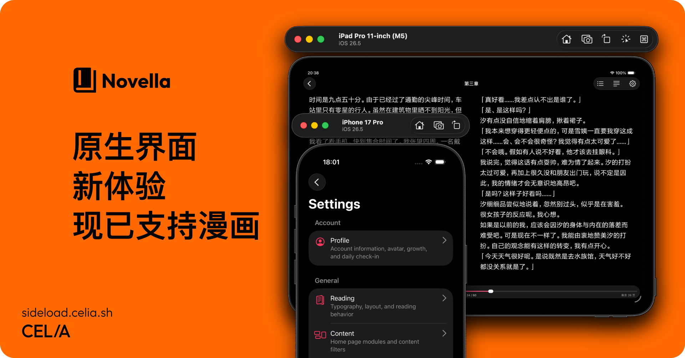

  

# 📚 Novella

  
  
  
  

轻书架第三方客户端，基于 React Native + Expo。

- `apps/mobile`：iOS 客户端。
- `packages/*`：与平台无关的客户端核心、协议。

原有的 Flutter 实现保留在 `archive/flutter` 分支上。

## 移动端开发

使用 Expo Development Build 开发。

开发工作流（首次构建、日常开发、重新生成原生工程）与代码规范（原生设计、图标、组件泛用性）见 [CONTRIBUTING.md](CONTRIBUTING.md)。

## 许可证

源代码以 AGPL-3.0 授权，具体见 [LICENSE](LICENSE)、[ADDITIONAL-TERMS.md](ADDITIONAL-TERMS.md) 和 [BRAND-ASSETS.md](BRAND-ASSETS.md)。
